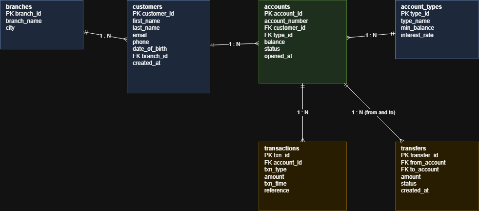
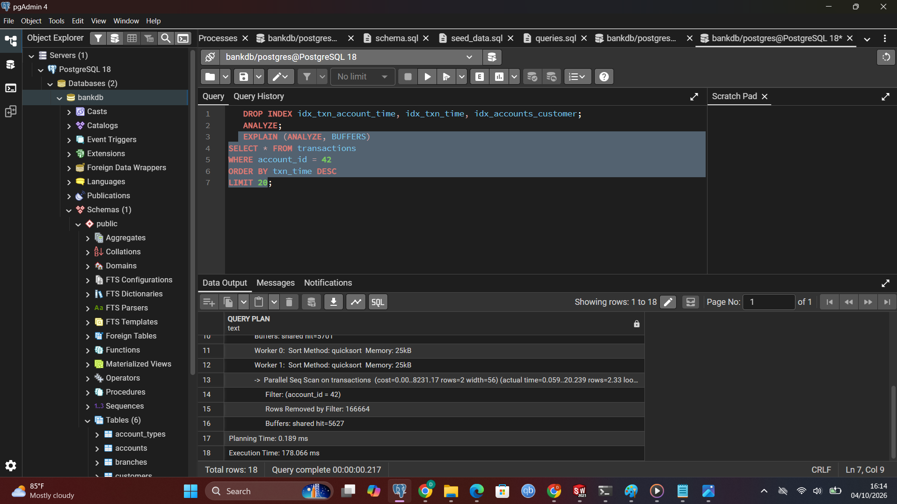
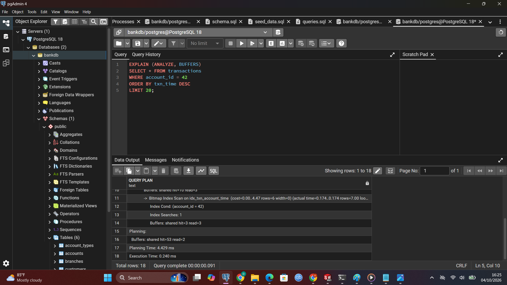
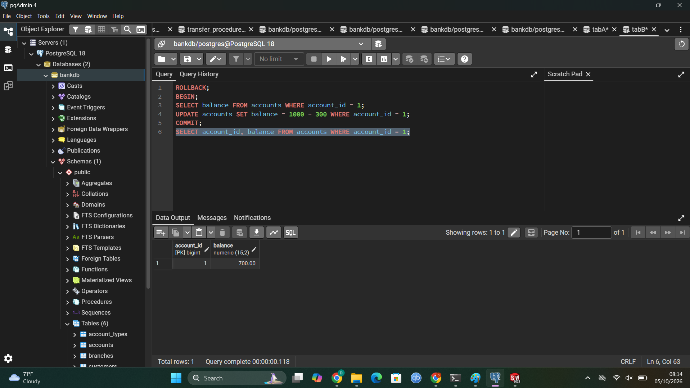
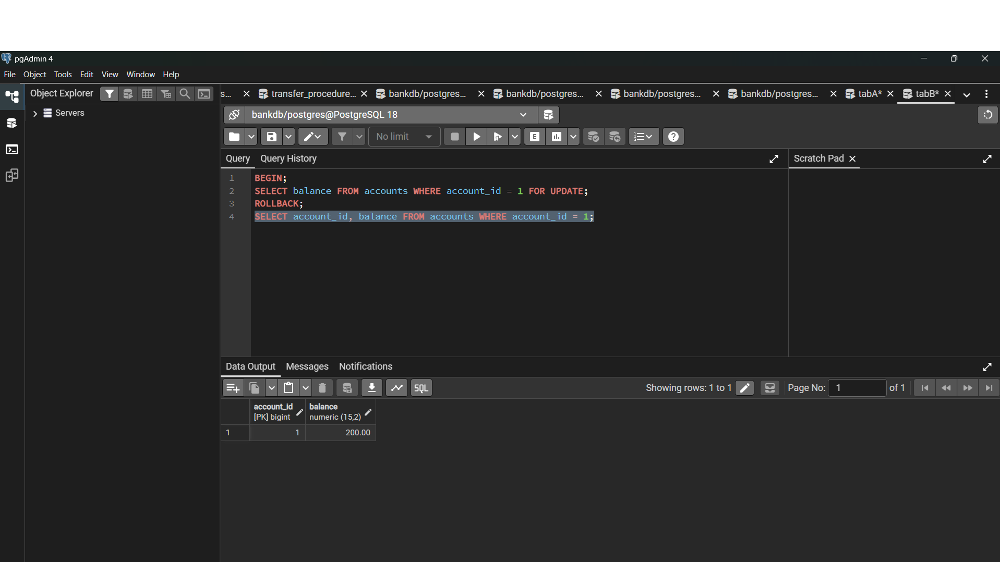
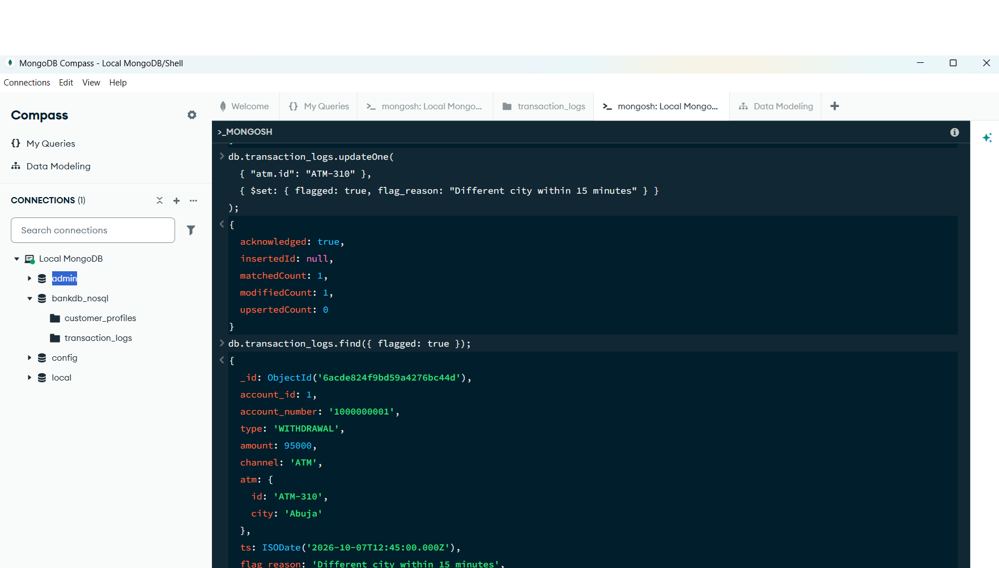
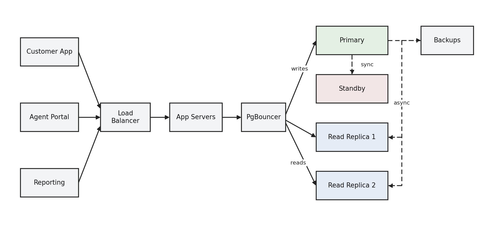

# Advanced Database Portfolio

**Case study: Paynest Bank (simulated)**

| Student name | |
|---|---|
| Matric number | |
| Student ID | |
| Date | |

## 1. Introduction

This repository contains five portfolios completed for an advanced database course. All five use one case study, Paynest Bank, a simulated retail bank in Nigeria that offers savings, current and fixed-deposit accounts and moves money through deposits, withdrawals and transfers. The bank is fictional and all data is synthetic. Working on a single case from start to finish shows how a decision made in the first portfolio affects performance, concurrency, flexibility and scalability in the later ones.

| No. | Topic | Main tools | Main outcome |
|---|---|---|---|
| 1 | Database design | PostgreSQL, pgAdmin 4, draw.io | Six-table normalised schema with keys and constraints |
| 2 | Query processing and optimisation | PostgreSQL EXPLAIN (ANALYZE, BUFFERS) | Indexes reduced the Q1 execution time from 178.066 ms to 0.240 ms |
| 3 | Transactions and concurrency | PostgreSQL, two Query Tool sessions | Demonstrated COMMIT, ROLLBACK, a lost update, row locking and isolation levels |
| 4 | NoSQL and advanced data models | MongoDB Community Server, Compass | Document model for customer profiles and transaction logs |
| 5 | Distributed and cloud databases | Documentation and architecture diagram | Primary-standby and managed cloud strategy with a future sharding plan |

Software used: PostgreSQL 18, pgAdmin 4, draw.io, MongoDB Community Server, MongoDB Compass, Git and GitHub.

## 2. Repository Structure

```
Advanced-Database-Portfolio/
  README.md                  this file
  portfolio1/                database design
    case-study.md, normalisation.md, schema.sql
    er-diagram.drawio, er-diagram.png, README.md
    01 and 02 screenshots
  portfolio2/                query processing and optimisation
    seed_data.sql, indexes.sql, README.md
    explain-before-q1/q2.txt, explain-after-q1/q2.txt
    timings-before.txt, numbered screenshots
  portfolio3/                transactions and concurrency
    transactions.sql, README.md, numbered screenshots
  portfolio4/                MongoDB
    mongo_demo.js, README_portfolio4.md, numbered screenshots
  portfolio5/                cloud strategy
    cloud-strategy.md, architecture-diagram.png, README.md
```

## 3. Portfolio 1: Database Design

**Purpose.** To design a relational database for the bank that stores each fact once and protects the data with rules. The case study (case-study.md) describes four groups of users: customers, bank tellers, branch managers and auditors. The data stored covers branches, customers, account types, accounts, transactions (the ledger) and transfers. The database must support opening accounts, deposits and withdrawals, transfers between accounts, reversal of failed transfers, balance audits and account statements.

**Design.** The schema has six tables. A branch has many customers, a customer has many accounts, and an account type applies to many accounts. Each account has many transactions and takes part in transfers as either the sending or the receiving account. The diagram was drawn in draw.io, and schema.sql creates the tables in PostgreSQL.



*Figure 1: Entity relationship diagram of the six tables*

**Keys and constraints.** Every table has a primary key. Foreign keys link customers to branches, accounts to customers and account types, transactions to accounts, and transfers to two accounts. NOT NULL protects important fields, and UNIQUE prevents duplicate emails, account numbers and transaction references. CHECK rules stop negative balances, amounts of zero or less, invalid status and transaction type values, and a transfer from an account to itself.

**Normalisation.** normalisation.md starts from one untidy table in which a customer's details repeat on every transaction row and one cell holds two phone numbers. First normal form is reached by storing one value per cell. Second normal form is reached by moving customer and account details into their own tables so that each transaction holds only its own facts. Third normal form is reached by moving branch city into the branches table and minimum balance and interest rate into the account types table, because they depend on the branch or type and not on the customer.

**A deliberate exception.** accounts.balance could be calculated by adding an account's transactions, so storing it is technically redundant. It is kept because reading a single value is much faster than summing a very large ledger, and an audit query is used to check that each balance matches its transactions.

**Challenge.** pgAdmin 4 first reported that its server could not be contacted. This was resolved by restarting the computer and running pgAdmin as an administrator, and it taught me that pgAdmin runs its own helper server separate from PostgreSQL.

## 4. Portfolio 2: Query Processing and Optimisation

**Data.** seed_data.sql generates synthetic data of about 700,000 rows: 5 branches, 3 account types, 50,000 customers, 80,000 accounts, 500,000 transactions and 100,000 transfers. It clears the tables first so it can be re-run, then runs ANALYZE and prints the row counts.

**Queries.** Five queries (Q1 to Q5) were run. Q1 returns the 20 most recent transactions for one account. Q2 joins transactions, accounts, customers and branches for a period of time and totals the amounts per branch. Q5 reports failed transfers. The results of all five are shown in the numbered screenshots.

**Indexes.** indexes.sql creates four indexes: a composite index on transactions (account_id, txn_time DESC) for Q1, an index on transactions (txn_time) for Q2, an index on accounts (customer_id) for the joins, and a partial index on transfers (created_at) restricted to failed transfers for Q5. A partial index is smaller and faster because it covers only the rows the query needs.

| Query | Plan before indexing | Plan after indexing | Execution time |
|---|---|---|---|
| Q1 | Parallel sequential scan of transactions; 166,664 rows removed per worker | Bitmap index scan on idx_txn_account_time | 178.066 ms to 0.240 ms (about 740 times faster) |
| Q2 | Parallel sequential scan of transactions, then hash joins | Bitmap index scan on idx_txn_time | 159.681 ms to 87.853 ms (about 45 percent faster) |



*Figure 2: Q1 execution plan before indexing (sequential scan)*



*Figure 3: Q1 execution plan after creating the indexes*

**What I learned.** An index helps most when a query selects a few rows, as Q1 does. Q2 improved less because it needs large parts of the accounts and customers tables, so the planner still reads them sequentially. Running the same query twice gave different times because the second run reads data from memory instead of disk, which is why the plans were compared as well as the times. Creating an index also made the application freeze once, and restarting it fixed this.

## 5. Portfolio 3: Transactions and Concurrency

This portfolio shows what the ACID properties mean in practice. It uses a stored procedure, transfer_funds(from, to, amount), that moves money between two accounts, writes the ledger rows and records the transfer in one transaction. Demos 3 to 5 use two Query Tool tabs, Tab A and Tab B, each of which is a separate database session. transactions.sql holds every demo in order.

| Demo | Screenshots | What was done | What it shows |
|---|---|---|---|
| 1. COMMIT | 02, 03 | Ran transfer_funds(1, 2, 10000) inside BEGIN, then COMMIT | Balances, ledger rows and the transfer record were saved together (atomicity and durability) |
| 2. ROLLBACK | 04 to 07 | Tried to transfer more than the balance, then rolled back; also rolled back a manual change | A failed or cancelled transaction leaves no trace (atomicity) |
| 3. Lost update | 08 to 09 | Both tabs read 1000; A withdrew 800 and committed; B withdrew 300 from its stale value | Final balance 700, so A's update was lost |
| 4. FOR UPDATE | 10 to 12 | Tab A locked the row with SELECT ... FOR UPDATE; Tab B waited | B saw 200, and the final balance was correct (isolation) |
| 5. Isolation levels | 13 to 18 | Compared REPEATABLE READ with READ COMMITTED while the other tab changed the balance | REPEATABLE READ keeps a stable snapshot and refuses an unsafe update; READ COMMITTED sees the latest saved data |



*Figure 4: Lost update. Tab B overwrites Tab A and the balance ends at 700*



*Figure 5: With FOR UPDATE the final balance is the correct 200*

**Key points.** The lost update happened because both tabs read 1000 before either saved. FOR UPDATE fixed it because Tab B had to wait and then saw the real balance. REPEATABLE READ suits reports and checks that need consistent data, as long as the application can retry after a serialisation error. READ COMMITTED is fine for simple everyday work. **Challenge:** Tab B first showed 1000 instead of waiting because the lock was not in place, so I confirmed that BEGIN and FOR UPDATE ran together in Tab A. A computer shutdown also rolled back the open transactions, so the demos had to be restarted.

## 6. Portfolio 4: NoSQL and Advanced Data Models

This portfolio stores the parts of the bank whose structure varies in MongoDB, in a database called bankdb_nosql. Two collections are used. customer_profiles holds KYC details, devices and alert preferences, which differ between customers. transaction_logs holds logs whose fields depend on the channel: ATM logs have an atm field, POS logs a pos field, branch deposits a branch field and mobile app logs a device field. The customer and account IDs match the PostgreSQL data from Portfolios 1 to 3. mongo_demo.js contains every command in numbered sections.

**Operations.** The commands cover inserting documents, three find queries (ATM transactions, amounts above 15000 and customers whose KYC is unverified), an update, an aggregation and an index. The update flags an ATM-310 withdrawal in Abuja that happened 15 minutes after an ATM withdrawal in Port Harcourt, and the new flagged and flag_reason fields were added to that one document without changing any other. The aggregation totals the amount and count per channel. Finally, an index on account_id and ts was created, and explain output was compared before and after.



*Figure 6: Updating and finding the flagged ATM-310 record in Compass*

**Why both databases.** Balances, transfers and the ledger stay in PostgreSQL because money needs ACID transactions, foreign keys and CHECK constraints, as Portfolio 3 showed. Profiles and logs go to MongoDB because storing them in SQL would need many empty columns or extra tables. **Challenge:** the Windows installer was hidden on the download page until I changed the platform options, the shell in Compass was not where I expected, and the new database did not appear in the sidebar, so I confirmed the inserts from the shell by counting documents and listing collections.

## 7. Portfolio 5: Distributed and Cloud Databases

This portfolio is a strategy document and not a hands-on cluster. cloud-strategy.md explains why the single-node PostgreSQL instance becomes a bottleneck during salary week, bulk agent collections and regulatory reporting, producing lock contention, saturated CPU and disk, and a single point of failure. It recommends three steps over time: first, asynchronous streaming replication with one primary for writes and one or two read replicas for statements, balance enquiries and reports; second, a managed service such as AWS RDS Multi-AZ, Google Cloud SQL or Supabase, which adds automatic failover, point-in-time recovery and encryption that supports CBN and NDPR expectations; third, sharding by branch_id or region once the bank outgrows a single cluster. A migration outline for moving to a managed instance is included.



*Figure 7: Proposed architecture with a primary, standby, two read replicas and backups*

## 8. How the Portfolios Fit Together

Portfolio 1 produces the schema. Portfolio 2 fills that schema with data and shows how indexes make queries fast. Portfolio 3 runs transactions against the same tables to show correctness under concurrent use. Portfolio 4 adds a document database that uses the same customer and account IDs, and Portfolio 5 explains how the whole system could grow and stay available.

## 9. How to Reproduce the Work

1. In pgAdmin 4, create a database called bankdb and run portfolio1/schema.sql.
2. Run portfolio2/seed_data.sql.
3. Run the five queries one at a time and capture EXPLAIN (ANALYZE, BUFFERS) for Q1 and Q2, then run portfolio2/indexes.sql and capture the plans again.
4. Create the transfer_funds procedure described in Portfolio 3, then run portfolio3/transactions.sql one block at a time, using two Query Tool tabs for demos 3 to 5.
5. Install MongoDB Community Server and Compass, connect to mongodb://localhost:27017, open the shell and paste the numbered sections of portfolio4/mongo_demo.js one at a time.

## 10. Lessons Learned

Good design decisions made early, such as keys, constraints and normalisation, make later work easier. Measuring with EXPLAIN is more reliable than guessing which index to build. Concurrency problems are invisible until two sessions touch the same row, so they must be tested deliberately. No single database suits every kind of data, and scaling is a design question as much as a hardware one. Many problems during the work were tool issues rather than database issues, and checking from the command line was a useful fallback when an interface did not update.

## 11. AI Acknowledgement

Claude, an AI assistant developed by Anthropic, was used to help prepare this README and to prepare the repository for publication. This included renaming the simulated company to Paynest Bank, removing personal identifiers from folder names and files, covering the former company name in two screenshots with a black bar, and summarising the contents of the five portfolios. The database designs, SQL scripts, experiments and screenshots in Portfolios 1 to 5 were produced by the student. The student reviewed the README and is responsible for its accuracy.

| Other AI use by the student (to be completed) | |
|---|---|

